<div align="center">
  <h1>PocketBudget</h1>
  <p><strong>Track every purchase. Plan each month. Spend with confidence.</strong></p>
  <p>A terminal-based Personal Expense Tracker and Budget Advisor built with Python.</p>

  
  
  
  
  
  
  
  
</div>

## Project overview

PocketBudget is a modular command-line project for keeping personal expense
and income records, setting monthly category budgets, and reviewing spending.
The interface uses Python's terminal `print()` and `input()` functions. It
does not use a graphical interface, web application, database, external API,
or login system.

The application stores data in local JSON files, analyzes monthly activity
with Pandas, exports Excel-friendly CSV statements, creates charts with
Matplotlib, and offers simple rule-based budgeting suggestions.

## Problem statement

It is easy to overlook small daily purchases or realize too late that a
category has exceeded its monthly limit. PocketBudget keeps records in one
local transaction file and turns them into clear summaries, budget alerts,
charts, and CSV statements.

## Key features

| Area | Features |
| --- | --- |
| Transactions | Add, view, edit, search, and confirm before deleting expenses; add and separately view income. |
| Validation | Re-prompt for invalid amounts, dates, months, categories, payment methods, and IDs. |
| Budgets | Set monthly limits by category and see remaining balances and over-budget amounts. |
| Reports | Monthly totals, category totals, weekly spending, average daily spending, highest-expense days, and top three categories. |
| Financial summary | Monthly income, expenses, current balance, savings, and savings percentage. |
| Exports | Export all monthly expense fields to a UTF-8 CSV that opens in spreadsheet applications. |
| Charts | Create five monthly charts, including category distribution and budget-versus-actual comparison. |
| Local data safety | Initialize missing JSON files, validate loaded records, and back up existing JSON before overwriting. |
| Terminal UI | Numbered menu, clear headings, confirmations, and safe ANSI color handling. |

## Technologies

| Technology | Use |
| --- | --- |
| Python 3.12+ | Application and screenshot-generation scripts |
| JSON | Local transaction and budget storage |
| Pandas | Spending analysis and CSV export |
| Matplotlib | Monthly charts |
| Pillow | Render terminal output and repository preview as PNGs |
| pytest | Automated tests using temporary data |

## Architecture

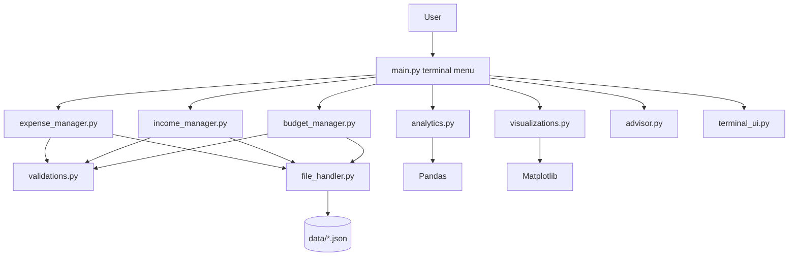

### Data flow

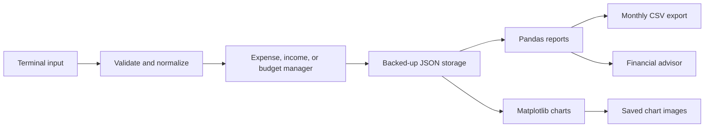

## Folder structure

```text
PocketBudget/
├── main.py
├── constants.py
├── validations.py
├── file_handler.py
├── expense_manager.py
├── income_manager.py
├── budget_manager.py
├── analytics.py
├── visualizations.py
├── advisor.py
├── terminal_ui.py
├── pytest.ini
├── requirements.txt
├── README.md
├── LICENSE
├── .gitignore
├── data/
│   └── .gitkeep
├── exports/
├── charts/
├── scripts/
│   └── generate_screenshots.py
├── tests/
│   └── test_pocketbudget.py
└── docs/
    ├── PROJECT_REPORT.md
    └── screenshots/
        ├── main-menu.png
        ├── add-expense.png
        ├── error-handling.png
        ├── budget-status.png
        ├── monthly-report.png
        ├── spending-analysis.png
        ├── csv-export.png
        ├── pytest-passed.png
        ├── github-repository.png
        ├── category-pie-chart.png
        ├── daily-spend-line-chart.png
        ├── budget-vs-actual-chart.png
        ├── monthly-category-bar-chart.png
        └── savings-summary-chart.png
```

`terminal_ui.py` centralizes user-facing terminal formatting. `income_manager.py`
keeps income entry/viewing separate from expense operations while both record
types share `data/expenses.json`. Existing JSON files are backed up to a
`.json.bak` sibling before they are replaced. Runtime JSON data is gitignored
to avoid publishing private transaction or budget records; missing files are
created automatically when the app starts.

## Installation

Use Python 3.12 or newer. From PowerShell in the project root:

```powershell
python -m venv .venv
.\.venv\Scripts\Activate.ps1
python -m pip install -r requirements.txt
```

If PowerShell prevents activation, run commands with
`.venv\Scripts\python.exe`. On macOS or Linux, create and activate the
environment with:

```bash
python3 -m venv .venv
source .venv/bin/activate
python -m pip install -r requirements.txt
```

## Run the project

```powershell
python main.py
```

Choose a numbered menu option and follow the prompts. The menu supports adding,
viewing, editing, deleting, and searching expenses; adding income; setting and
checking category budgets; viewing monthly reports and spending analysis;
exporting CSV; generating charts; and receiving financial advice. Dates use
`YYYY-MM-DD`, months use `YYYY-MM`, and amounts must be positive finite
numbers.

## Run the tests

From the project root, either command works:

```powershell
python -m pytest -v
```

```powershell
pytest -v
```

`pytest.ini` configures the project root as the import path and sets
`tests/` as the test directory. File and CSV tests use temporary directories;
they do not read or modify the real `data/` files.

## Usage and storage

### Transaction JSON

Expenses and income share `data/expenses.json`. Each record has an integer
`id` and `type`; expense records contain all required expense fields:

```json
[
  {
    "id": 1,
    "type": "expense",
    "amount": 250.0,
    "category": "Food",
    "date": "2026-11-17",
    "description": "Lunch and snacks",
    "payment_method": "UPI"
  },
  {
    "id": 2,
    "type": "income",
    "amount": 1200.0,
    "date": "2026-11-01",
    "source": "Part-time work",
    "description": "November payment"
  }
]
```

`data/budgets.json` maps a month directly to category amounts:

```json
{
  "2026-11": {
    "Food": 3000.0,
    "Travel": 1500.0,
    "Shopping": 2000.0
  }
}
```

Missing JSON files are initialized. Invalid JSON is reported without
overwriting the user's file. JSON updates use an atomic replacement and keep
the previous version in a `.json.bak` backup.

### CSV export

The CSV export option writes
`exports/expense_statement_YYYY-MM.csv`. It includes all expense fields in
this order: `id`, `type`, `amount`, `category`, `date`, `description`, and
`payment_method`. A UTF-8 BOM improves compatibility with spreadsheet
applications, and descriptions containing commas are correctly quoted.

## Screenshots

The terminal screenshots are rendered from captured output of the actual
PocketBudget functions using an isolated temporary demo dataset. The output is
shown inside a Windows Terminal-style frame; the frame is presentation only
and does not add text to the captured application output. No macOS-style
window controls are used. The repository preview remains a separate Pillow
illustration, not a browser screenshot.

Regenerate the documentation images from the project root with:

```powershell
python scripts/generate_screenshots.py
```

The generator also rebuilds the chart images from the demo data. It does not
change the application's chart implementation or chart styling.

### Main menu

The actual terminal menu lists the supported expense, budget, reporting, and
advisor operations.

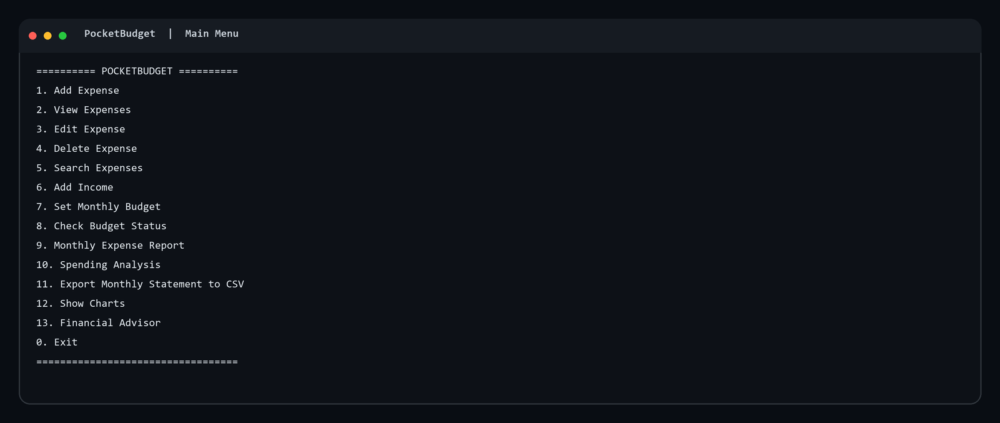

### Add expense

Shows a valid expense entry and the success message produced by the application.

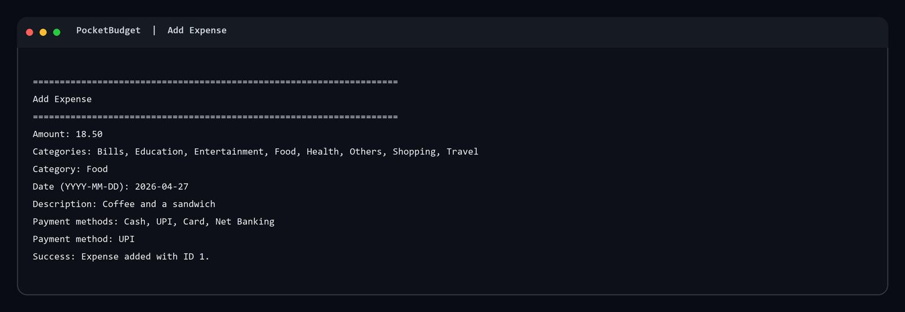

### Error handling

An invalid amount is rejected and the prompt retries instead of terminating
the program.

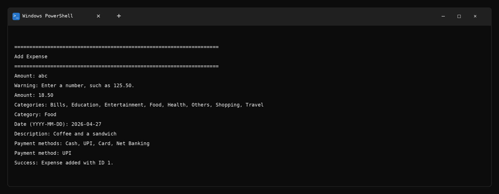

### Budget status

Shows category limits, actual spending, remaining amounts, and budget alerts.

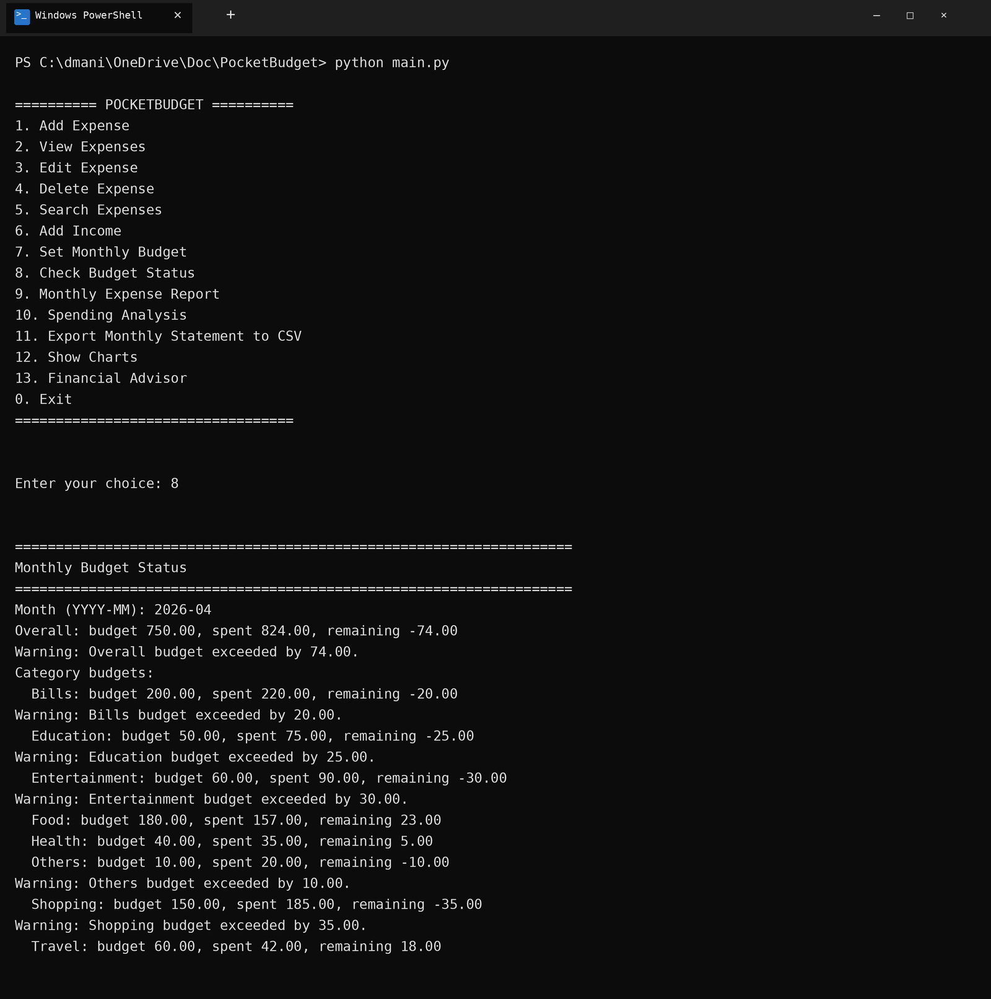

### Monthly report

Displays monthly total, transaction count, average daily spend, category totals,
and weekly totals.

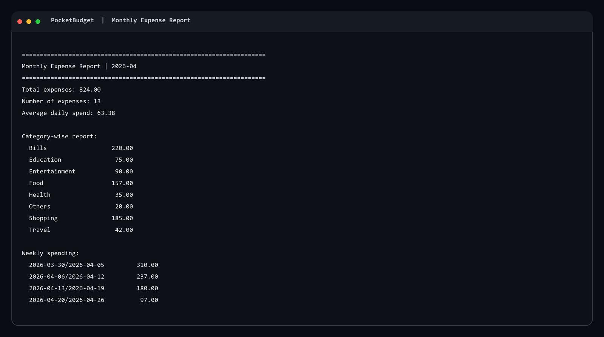

### Spending analysis

Shows Pandas category and weekly analysis, daily average, and highest-spending
days.

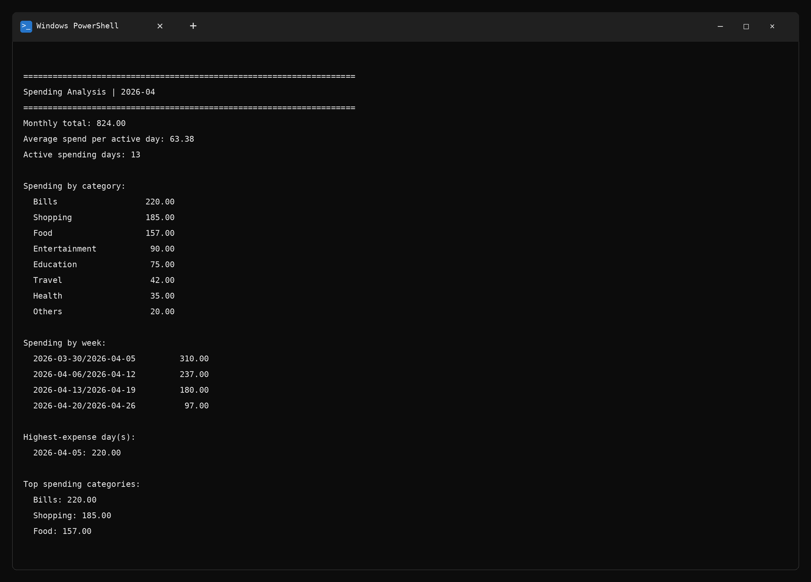

### CSV export

Displays the successful export message and a preview of the generated demo CSV.

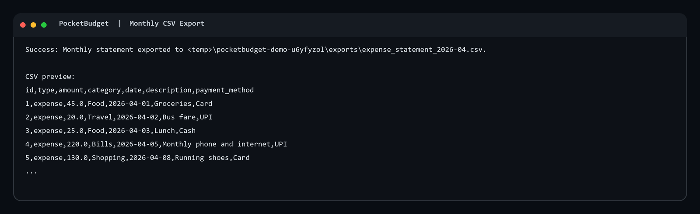

### Passing pytest run

This image captures the output of the real `python -m pytest -v` command.

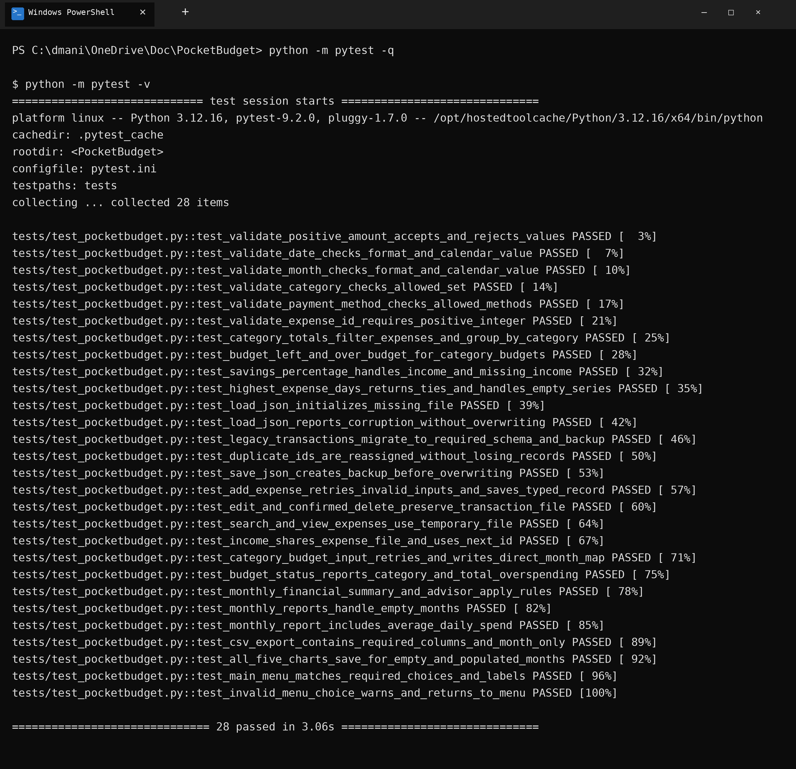

### Repository preview

A locally rendered GitHub-style view of the project files and README.

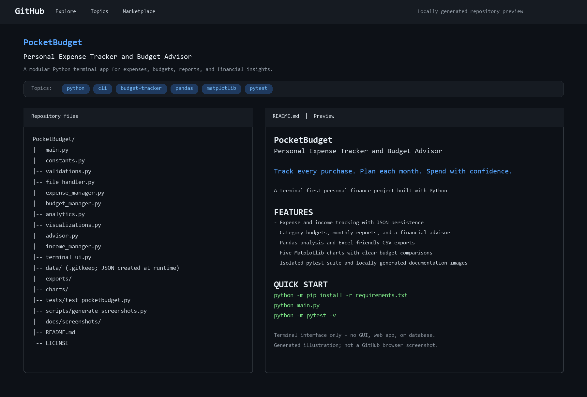

## Charts

Charts are generated from the same temporary demo transactions and budgets
when the documentation images are built. Normal application charts are saved
to `charts/`; these README copies are in `docs/screenshots/`.

### Category-wise expense distribution

The pie chart labels the category shares with percentages.

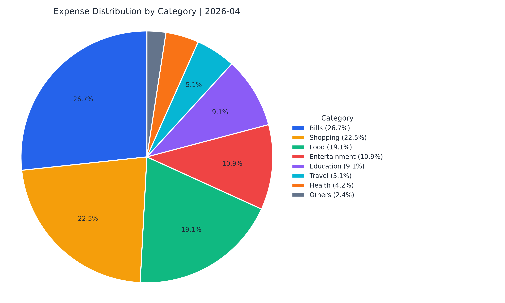

### Daily spending trend

The line chart uses markers and a shaded area to make daily movement easier to
read.

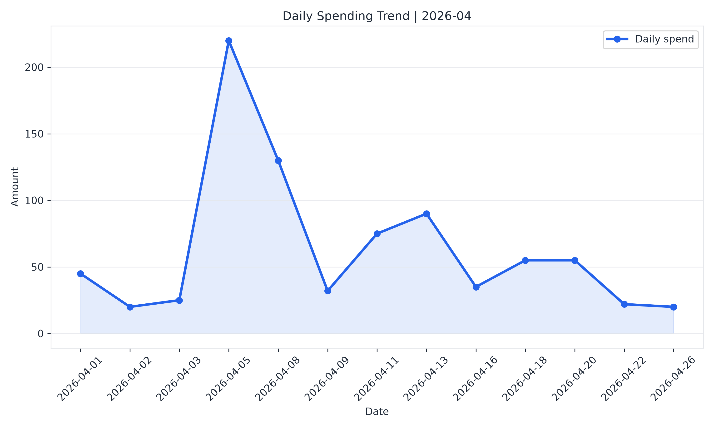

### Budget versus actual spending

Grouped bars compare each category's limit with actual spending; actual
over-budget bars are highlighted in red.

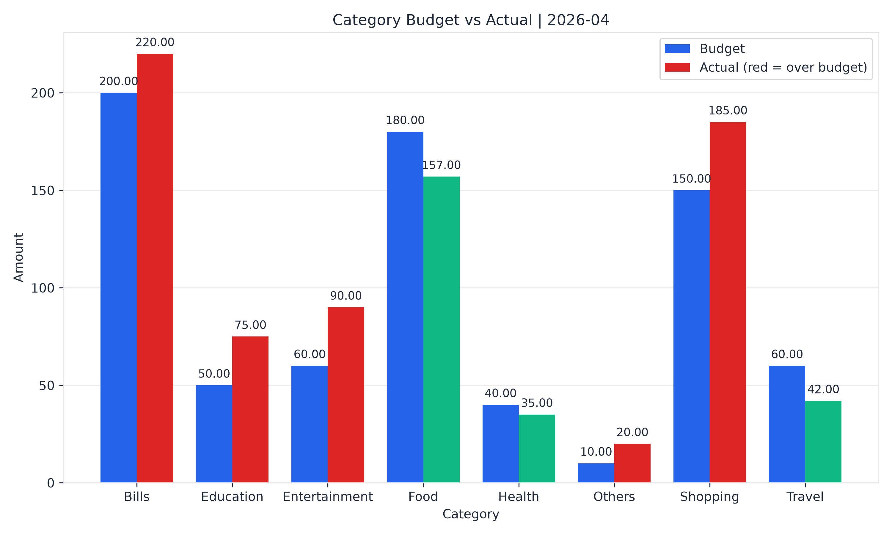

### Monthly category spending

The bar chart shows category totals with value labels.

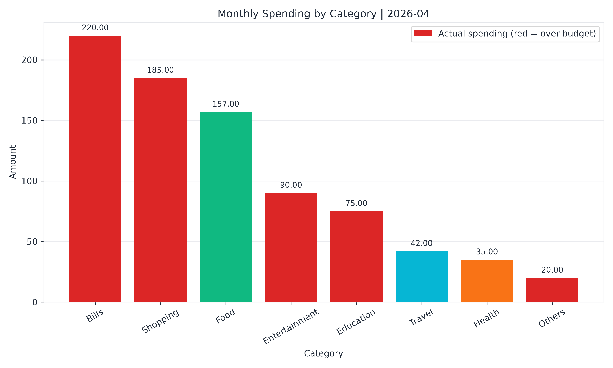

### Savings summary

The chart compares demo-month income, expenses, and savings.

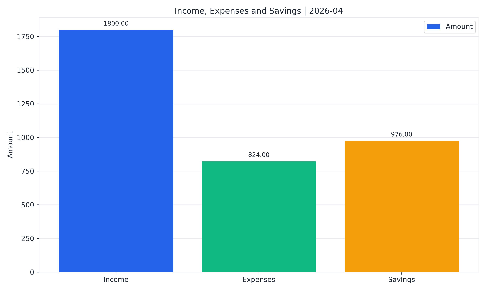

## Financial advisor

The advisor summarizes income, expenses, current balance, and savings. It
identifies the highest-spending category, reports categories over budget, warns
when expenses exceed 80% of income, suggests reducing a category that exceeds
40% of spending, and recommends aiming to save at least 20% of income. Advice
is rule-based and is not professional financial guidance.

## Testing

The pytest suite covers input validation, expense/income separation, unique
IDs, JSON initialization and backups, category totals, budget calculations,
savings, highest-expense days, CSV output, empty and populated charts, and
menu behavior. Tests use temporary data so real user records remain untouched.

## Project report

See [docs/PROJECT_REPORT.md](docs/PROJECT_REPORT.md) for the project objective,
data design, module responsibilities, validation strategy, and limitations.

See [docs/EVALUATION_GUIDE.md](docs/EVALUATION_GUIDE.md) for a step-by-step
live demonstration plan, key financial formulas, architecture explanation,
common viva questions, and a submission checklist.

## Team contribution

Replace the placeholders with the actual team members before submission.

| Team member | Contribution |
| --- | --- |
| Member 1 | Transaction management and JSON storage |
| Member 2 | Budgets, validation, and financial advisor |
| Member 3 | Pandas analysis, charts, and CSV export |
| Member 4 | Tests, screenshots, and documentation |

## Future scope

- Add recurring expenses and optional reminders.
- Support configurable currency display and additional report periods.
- Add user-defined savings goals and configurable advisor thresholds.
- Offer optional encrypted local backups and printable statements.

## Contributing

Contributions should preserve the terminal-only interface, local JSON storage,
and the beginner-friendly modular structure. Before proposing a change, run
`python -m pytest -v` and regenerate the documentation images if the displayed
output or charts have changed.

## License

PocketBudget is released under the MIT License. See [LICENSE](LICENSE).

## Acknowledgements

Built with Python, Pandas, Matplotlib, Pillow, and pytest. Thanks to the
maintainers of these open-source projects and to educators who encourage
hands-on programming practice.

## Contact

No public maintainer contact is configured yet. Add a project email address or
GitHub Discussions link here before publishing the repository.
